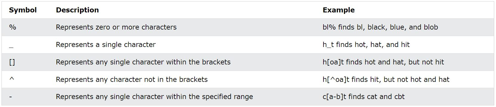

## SELECT Statement
```md
The SELECT statement is used to select data from a database.

The data returned is stored in a result table, called the result-set.

SELECT Syntax
SELECT column1, column2, ...
FROM table_name;

Here, column1, column2, ... are the field names of the table you want to select data from. If you want to select all the fields available in the table, use the following syntax:

SELECT * FROM table_name;
```
## SELECT DISTINCT Statement
```md
The SELECT DISTINCT statement is used to return only distinct (different) values.

Inside a table, a column often contains many duplicate values; and sometimes you only want to list the different (distinct) values.

SELECT DISTINCT Syntax
SELECT DISTINCT column1, column2, ...
FROM table_name;
```

## AND , OR, NOT

The SQL WHERE Clause
The WHERE clause is used to filter records.

It is used to extract only those records that fulfill a specified condition.

**WHERE Syntax**
```md
SELECT column1, column2, ...
FROM table_name
WHERE condition;
```
> Note: The WHERE clause is not only used in SELECT statements, it is also used in UPDATE, DELETE, etc.!

The SQL AND, OR and NOT Operators

The WHERE clause can be combined with AND, OR, and NOT operators.

The AND and OR operators are used to filter records based on more than one condition:

The AND operator displays a record if all the conditions separated by AND are TRUE.

The OR operator displays a record if any of the conditions separated by OR is TRUE.

The NOT operator displays a record if the condition(s) is NOT TRUE.
```md
AND Syntax
SELECT column1, column2, ...
FROM table_name
WHERE condition1 AND condition2 AND condition3 ...;

OR Syntax
SELECT column1, column2, ...
FROM table_name
WHERE condition1 OR condition2 OR condition3 ...;

NOT Syntax
SELECT column1, column2, ...
FROM table_name
WHERE NOT condition;
```
## SQL IN Operator
The IN operator allows you to specify multiple values in a WHERE clause.

The IN operator is a shorthand for multiple OR conditions.

IN Syntax
```md
SELECT column_name(s)
FROM table_name
WHERE column_name IN (value1, value2, ...);

or:

SELECT column_name(s)
FROM table_name
WHERE column_name IN (SELECT STATEMENT);
```
## Sorting : Order By

The SQL ORDER BY Keyword
The ORDER BY keyword is used to sort the result-set in ascending or descending order.

The ORDER BY keyword sorts the records in ascending order by default. 

To sort the records in descending order, use the DESC keyword.

ORDER BY Syntax
```md
SELECT column1, column2, ...
FROM table_name
ORDER BY column1, column2, ... ASC|DESC;
```

## Select Top Statement

The SQL SELECT TOP Clause
The SELECT TOP clause is used to specify the number of records to return.

The SELECT TOP clause is useful on large tables with thousands of records. 

Returning a large number of records can impact performance.

Note: Not all database systems support the SELECT TOP clause. 

MySQL supports the LIMIT clause to select a limited number of records, while Oracle uses FETCH FIRST n ROWS ONLY and ROWNUM.

SQL Server / MS Access Syntax:
```md
SELECT TOP number|percent column_name(s)
FROM table_name
WHERE condition;
```
## Select As

SQL Aliases
SQL aliases are used to give a table, or a column in a table, a temporary name.

Aliases are often used to make column names more readable.

An alias only exists for the duration of that query.

An alias is created with the AS keyword.
```md
Alias Column Syntax
SELECT column_name AS alias_name
FROM table_name;
```
## The SQL BETWEEN Operator
The BETWEEN operator selects values within a given range. The values can be numbers, text, or dates.

The BETWEEN operator is inclusive: begin and end values are included. 

BETWEEN Syntax
```md
SELECT column_name(s)
FROM table_name
WHERE column_name BETWEEN value1 AND value2;
```

### The SQL COUNT(), AVG() and SUM() Functions
## The COUNT() function returns the number of rows that matches a specified criterion.
```md
COUNT() Syntax
SELECT COUNT(column_name)
FROM table_name
WHERE condition;
```
## AVG() function returns the average value of a numeric column. 
```md
AVG() Syntax
SELECT AVG(column_name)
FROM table_name
WHERE condition;
```
## SUM() function returns the total sum of a numeric column. 
```md
SUM() Syntax
SELECT SUM(column_name)
FROM table_name
WHERE condition;
```
## SQL MIN() and MAX() Functions
```md
The MIN() function returns the smallest value of the selected column.

The MAX() function returns the largest value of the selected column.

MIN() Syntax
SELECT MIN(column_name)
FROM table_name
WHERE condition;

MAX() Syntax
SELECT MAX(column_name)
FROM table_name
WHERE condition;
```

## GROUP BY Statement
The GROUP BY statement groups rows that have the same values into summary rows, like "find the number of customers in each country".

The GROUP BY statement is often used with aggregate functions (COUNT(), MAX(), MIN(), SUM(), AVG()) to group the result-set by one or more columns.

## GROUP BY Syntax
```md
SELECT column_name(s)
FROM table_name
WHERE condition
GROUP BY column_name(s)
ORDER BY column_name(s);
```

## Having

The SQL HAVING Clause
The HAVING clause was added to SQL because the WHERE keyword cannot be used with aggregate functions in a direct way.

HAVING Syntax
```md
SELECT column_name(s)
FROM table_name
WHERE condition
GROUP BY column_name(s)
HAVING condition
ORDER BY column_name(s);
```
## LIKE Operator
The LIKE operator is used in a WHERE clause to search for a specified pattern in a column.

There are two wildcards often used in conjunction with the LIKE operator:

> The percent sign (%) represents zero, one, or multiple characters
> The underscore sign (_) represents one, single character


> Note: MS Access uses an asterisk (*) instead of the percent sign (%), and a question mark (?) instead of the underscore (_).

The percent sign and the underscore can also be used in combinations!
```md
LIKE Syntax
SELECT column1, column2, ...
FROM table_name
WHERE columnN LIKE pattern;
```
> Tip: You can also combine any number of conditions using AND or OR operators.
Wildcard Characters
A wildcard character is used to substitute one or more characters in a string.

Wildcard characters are used with the LIKE operator. The LIKE operator is used in a WHERE clause to search for a specified pattern in a column.

Wildcard Characters in SQL Server

